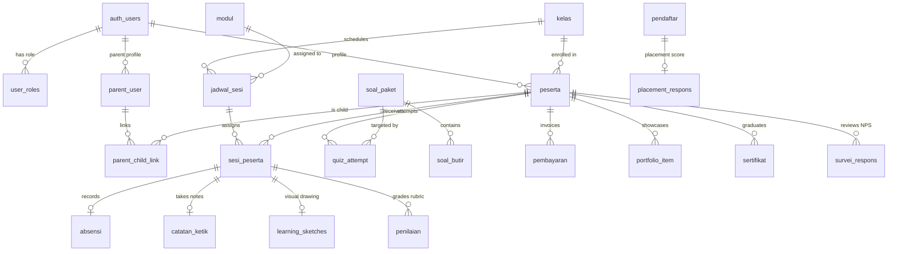

# Dokumentasi Arsitektur Database & Seeding — Paham AI

Dokumen ini mencatat seluruh alur skema database, relasi entitas, hasil refaktor model, dan panduan lengkap seeding data demo untuk aplikasi **Paham AI**.

---

## 1. Ringkasan Arsitektur & Evolusi Skema

Database Paham AI menggunakan **PostgreSQL pada Supabase** dengan proteksi keamanan **Row Level Security (RLS)** dan pemisahan hak akses berbasis peran (*role-based access control*).

### Evolusi Penting (Refaktor Migration 0028):
1. **Konsep `batch` & `jalur` Dihapus Total:**
   - Dulu: Ada tabel `batch` dan kolom `jalur` (`A`, `B1`, `B2`, `B3`) yang disimpan di 4 tabel terpisah tanpa *foreign key* yang seragam. Hal ini memicu inkonsistensi data.
   - Sekarang: Disederhanakan menjadi tabel **`kelas`** (angkatan belajar) dan taksonomi konten memakai **`modul.kategori`** (`FND`, `TOOL`, `PRMP`, `PROD`, `ETHC`, `CODE`, `AUTO`, `ARCH`, `PROJ`, `PRES`).
2. **Jantung Hak Akses Modul: `sesi_peserta`:**
   - Murid tidak lagi membuka modul berdasarkan label jalur.
   - Murid **hanya** dapat mengakses materi, absensi, kuis, dan tugas jika tutor/admin telah menugaskannya melalui tabel penghubung **`sesi_peserta`** (`jadwal_sesi_id` ⟷ `peserta_id`).

---

## 2. Peta Relasi Entitas (ERD)



---

## 3. Detail Entitas & Fungsinya

| Tabel | Fungsi & Deskripsi | Kunci Utama / Relasi |
|---|---|---|
| **`auth.users`** | Akun pengguna bawaan Supabase Auth (email, password hash, metadata). | `id` (UUID) |
| **`user_roles`** | Pemetaan peran: `admin`, `instruktur`, `peserta`, `parent`, `marketing`. | `user_id -> auth.users.id` |
| **`kelas`** | Angkatan kelas kursus (nama, kode, tanggal mulai/akhir, kapasitas, instruktur). | `id` (UUID), `instruktur_utama_fk` |
| **`modul`** | Silabus kurikulum (kode `B101` dsb, judul, kategori, durasi, materi markdown). | `id` (UUID), `kode` (UNIQUE) |
| **`jadwal_sesi`** | Sesi pertemuan terjadwal untuk kelas tertentu (jam, tanggal, link rapat, lokasi). | `kelas_id -> kelas.id`, `modul_id -> modul.id` |
| **`peserta`** | Profil murid (nama, usia, NIK, kontak, consent privasi/etika, kelas). | `user_id -> auth.users.id`, `kelas_id -> kelas.id` |
| **`sesi_peserta`** | **Penugasan sesi ke murid.** Mengontrol buka-tutup akses belajar. | `sesi_id -> jadwal_sesi.id`, `peserta_id -> peserta.id` |
| **`absensi`** | Kehadiran murid (`hadir`, `izin`, `alpha`, `telat`, menit telat, verifikasi tutor). | `sesi_peserta_id -> sesi_peserta.id` (UNIQUE) |
| **`catatan_ketik`** | Catatan pemahaman murid dalam format teks Markdown. | `sesi_peserta_id -> sesi_peserta.id` (UNIQUE) |
| **`learning_sketches`** | Kanvas coretan visual peserta berbasis JSON Snapshot (TLDraw). | `sesi_peserta_id -> sesi_peserta.id` (UNIQUE) |
| **`soal_paket` & `soal_butir`** | Bank kuis, pre-test, dan post-test beserta kunci dan pembahasannya. | `kode_paket` |
| **`quiz_attempt`** | Rekam jejak jawaban murid saat mengerjakan kuis per butir soal. | `id_peserta_fk -> peserta.id`, `kode_paket` |
| **`pembayaran`** | Rekod finansial murid (total biaya, jumlah terbayar, cicilan, status lunas). | `peserta_id -> peserta.id` |
| **`portfolio_item`** | Galeri hasil tugas/karya proyek capstone murid (GitHub, Figma, tautan demo). | `id_peserta_fk -> peserta.id` |
| **`sertifikat`** | Sertifikat resmi kelulusan dengan nomor seri unik dan predikat. | `id_peserta_fk -> peserta.id` |
| **`pendaftar` & `placement_respons`** | Prospek pendaftaran leads marketing dan hasil tes penempatan level. | `id_pendaftar_fk -> pendaftar.id` |
| **`survei_respons`** | Umpan balik kepuasan (Net Promoter Score / NPS) dari murid & orang tua. | `kelas_id -> kelas.id`, `id_peserta_fk` |

---

## 4. Panduan & Perintah Eksekusi Seeding

Seluruh skrip seeding berada di folder `/scripts` dan terhubung otomatis dengan kredensial di file `.env`.

### 1. Seeding Akun & Profil (`seed-users.mjs`)
Membuat atau memperbarui user Supabase Auth beserta profil `peserta`, `parent_user`, dan `user_roles`.
```bash
node scripts/seed-users.mjs
```

**Kredensial Demo yang Dibuat:**
- Admin: `admin@paham.ai` / `Admin123!`
- Instruktur: `tutor@paham.ai` / `Tutor123!`
- Peserta 1 (Budi): `murid@paham.ai` / `Murid123!` (Kelas B1)
- Peserta 2 (Siti): `murid2@paham.ai` / `Murid123!` (Kelas A)
- Orang Tua: `ortu@paham.ai` / `Ortu1234!` (Terhubung ke Budi)
- Marketing: `marketing@paham.ai` / `Marketing123!`

### 2. Seeding Penugasan Sesi Murid (`seed-penugasan.mjs`)
Menjadwalkan modul `B101` sampai `B107` dan menugaskannya ke akun `murid@paham.ai`.
```bash
node scripts/seed-penugasan.mjs
```

### 3. Master Seeding Lengkap (`seed-complete.mjs`)
Skrip komprehensif yang menginjeksi seluruh aktivitas pembelajaran, pembayaran, portfolio, sertifikat, dan leads penempatan secara idempoten:
```bash
node scripts/seed-complete.mjs
```

### 4. Verifikasi Integritas Database (`verify-0029.mjs`)
Memeriksa bahwa tidak ada relasi menggantung, kolom lawas yang tersisa, atau inkonsistensi jadwal:
```bash
node scripts/verify-0029.mjs
```
