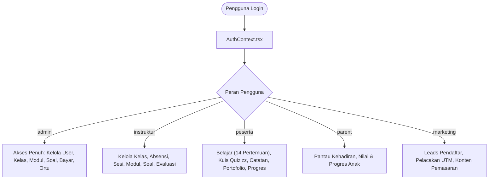
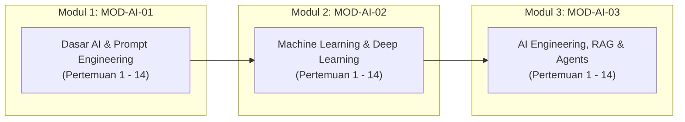
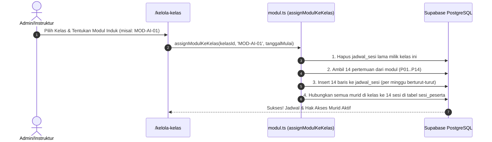
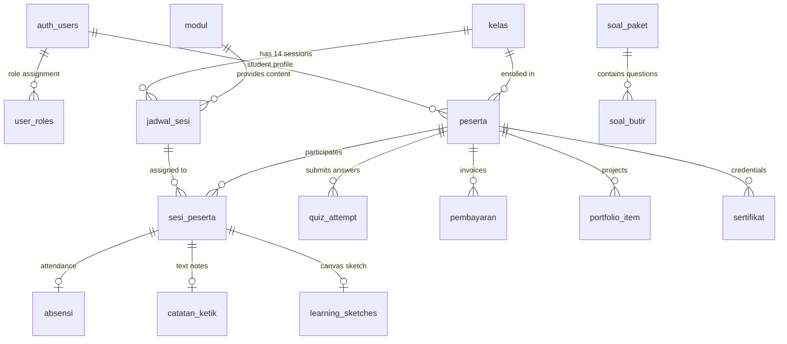

# Product Requirements Document (PRD) & Handover Teknis: Paham AI

**Versi Dokumen:** 2.0 (Post-Refactor Kurikulum 14 Pertemuan & Engine Kuis Quizizz)  
**Target Pembaca:** Software Engineer / Full-Stack Developer yang melanjutkan proyek ini  
**Tech Stack:** React 18, TypeScript, Vite, Tailwind CSS, Supabase (PostgreSQL, Auth, RLS, RPC), PWA  
**Status Produksi:** Aktif & Siap Dikembangkan Lebih Lanjut  

---

## 1. Executive Summary & Ringkasan Produk

### 1.1 Apa itu Paham AI?
**Paham AI** adalah platform *Learning Management System* (LMS) modern dan terintegrasi untuk pembelajaran Artificial Intelligence (AI) berstandar kurikulum perguruan tinggi (semester 14 pertemuan / 2 SKS) serta pelatihan profesional.

Platform ini memfasilitasi interaksi *end-to-end* antara:
1. **Calon Peserta / Mahasiswa:** Mengakses silabus, membaca materi markdown kaya fitur, membuat catatan belajar, menggambar diagram pemikiran (kanvas visual), mengerjakan kuis interaktif bergaya **Quizizz**, serta memantau progres kehadiran dan nilai.
2. **Instruktur / Dosen:** Mengelola kelas, menugaskan modul 14 pertemuan ke kelas, memantau absensi, menginisiasi sesi kuis kelas, dan menilai penugasan.
3. **Administrator:** Mengontrol akses pengguna, membuat dan merename kelas, mengonfigurasi modul silabus, memanajemen bank soal, dan memvalidasi pembayaran.
4. **Orang Tua / Wali:** Memantau kemajuan belajar anak secara berkala (kehadiran, skor kuis, dan resume materi).
5. **Marketing:** Menganalisis prospek pendaftar (*leads*), sumber akuisisi (UTM), serta menyiapkan aset konten promosi.

---

## 2. User Roles & Role-Based Access Control (RBAC)

Aplikasi memiliki 5 peran pengguna (*roles*) yang disimpan di tabel `user_roles` dan disinkronkan ke Supabase Auth Metadata:



### Matriks Hak Akses Per Halaman

| Rute URL | Halaman | Admin | Instruktur | Peserta | Parent | Marketing | Keterangan |
|---|---|:---:|:---:|:---:|:---:|:---:|---|
| `/` | Landing Page | ✅ | ✅ | ✅ | ✅ | ✅ | Halaman publik, silabus ringkas, pendaftaran |
| `/pendaftaran` | Pendaftaran | ✅ | ✅ | ✅ | ✅ | ✅ | Form leads calon murid / placement |
| `/masuk` & `/daftar` | Auth | ✅ | ✅ | ✅ | ✅ | ✅ | Supabase Authentication |
| `/app` | Beranda Portal | ✅ | ✅ | ✅ | ✅ | ✅ | Dashboard ringkasan sesuai peran |
| `/belajar` | Ruang Belajar | ❌ | ❌ | ✅ | ❌ | ❌ | Silabus 14 pertemuan kelas aktif |
| `/modul/:kode` | Sesi Belajar | ✅ | ✅ | ✅ | ❌ | ❌ | Ruang baca materi, catatan & kuis |
| `/kuis` | Katalog Kuis | ❌ | ❌ | ✅ | ❌ | ❌ | Kuis modul yang ditugaskan ke kelasnya |
| `/progres` & `/karya` | Progres & Portofolio | ❌ | ❌ | ✅ | ❌ | ❌ | Rekap capaian & galeri proyek murid |
| `/kelola-kelas` | Kelola Kelas | ✅ | ✅ | ❌ | ❌ | ❌ | Bikin kelas, rename, assign modul & kuis |
| `/kelola-modul` | Kelola Modul | ✅ | ✅ | ❌ | ❌ | ❌ | Editor silabus & materi markdown |
| `/kelola-soal` | Kelola Bank Soal | ✅ | ✅ | ❌ | ❌ | ❌ | Manajemen paket & butir soal kuis |
| `/absensi` | Presensi Kelas | ✅ | ✅ | ❌ | ❌ | ❌ | Pencatatan & verifikasi kehadiran murid |
| `/kelola-user` | Kelola Akun | ✅ | ❌ | ❌ | ❌ | ❌ | Manajemen user & ganti role |
| `/pembayaran` | Pembayaran | ✅ | ❌ | ❌ | ❌ | ❌ | Verifikasi bukti bayar & invoice |
| `/anak` | Portal Ortu | ❌ | ❌ | ❌ | ✅ | ❌ | Pantauan belajar anak asuh |
| `/marketing` | Pemasaran | ✅ | ❌ | ❌ | ❌ | ✅ | Dashboard funnel prospek & UTM |

---

## 3. Arsitektur Domain & Model Bisnis

### 3.1 Perubahan Fundamental: Pembersihan Sistem Lama
> [!IMPORTANT]
> **Catatan Historis untuk Programmer:**  
> Sistem versi awal menggunakan konsep *Jalur Belajar* (Anak / A, Pemula / B1, Menengah / B2, Expert / B3) dan konsep `batch`. **Sistem ini telah dihapus sepenuhnya** karena membingungkan dan tidak sesuai kebutuhan perkuliahan/profesional.
>
> **Sistem Baru yang Aktif Saat Ini:**
> 1. Menggunakan 3 **Modul Utama** (`MOD-AI-01`, `MOD-AI-02`, `MOD-AI-03`).
> 2. Masing-masing modul terdiri dari **14 Pertemuan Terstruktur** (P01 s/d P14, 100 menit/pertemuan setara 2 SKS).
> 3. Entitas kelas menggunakan tabel **`kelas`** yang terhubung ke satu modul utama melalui `jadwal_sesi`.

### 3.2 Tiga Pilar Modul Kurikulum Perkuliahan



1. **`MOD-AI-01` — Dasar Kecerdasan Buatan & Prompt Engineering (14 Pertemuan):**
   - Teori model generatif, tokenisasi, prompting terstruktur (JSON, CoT, Few-Shot), etika, jailbreak defense, hingga UTS (P08) & UAS Portofolio (P14).
2. **`MOD-AI-02` — Machine Learning & Deep Learning (14 Pertemuan):**
   - Python & Math ML, Supervised Learning, Unsupervised Learning, ANN, CNN, RNN, Transformer architecture, UTS (P08) & Capstone ML (P14).
3. **`MOD-AI-03` — AI Engineering, RAG & Autonomous Agents (14 Pertemuan):**
   - Cloud LLM API, Vector Database (ChromaDB/pgvector), Hybrid Search RAG, Tool-Use/Function Calling, Multi-Agent LangGraph, UTS (P08) & UAS Production Deployment (P14).

### 3.3 Relasi Kelas, Modul, dan Hak Akses Belajar
Sistem penugasan modul ke kelas bekerja secara deterministik di `src/services/modul.ts`:



- **Prinsip Isolasi Akses:** Murid hanya dapat melihat modul dan kuis yang ditugaskan ke kelasnya via relasi `peserta.kelas_id` ➔ `jadwal_sesi.kelas_id`.

---

## 4. Mesin Gamifikasi Kuis Bergaya Quizizz

Aplikasi memiliki mesin kuis interaktif di `src/components/quiz/QuizizzPlayer.tsx` yang meniru *gameplay loop* Quizizz:

### 4.1 Mekanisme Gameplay Kuis
1. **Opsi 4 Warna Identik Quizizz:**
   - Opsi A: Merah / Rose (`bg-rose-600`)
   - Opsi B: Biru / Indigo (`bg-blue-600`)
   - Opsi C: Kuning / Amber (`bg-amber-600`)
   - Opsi D: Hijau / Emerald (`bg-emerald-600`)
2. **Timer Countdown Visual:** Menggunakan lingkaran progress SVG `TimerRing.tsx` dengan interval detik yang dapat disesuaikan.
3. **Streak & Multiplier Score:**
   - Menjawab benar berturut-turut memicu *Streak Fire* (`🔥 Streak 2x`, `3x`).
   - Bonus skor kecepatan: makin cepat menjawab, makin tinggi perolehan poin.
4. **Instant Feedback & Audio SFX:**
   - Efek suara sintetis Web Audio API: bunyi *ding* saat benar, *thud* saat salah, dan *fanfare* saat menang.
   - Haptic & visual feedback: tombol berubah hijau (benar) atau merah getar (salah), disertai kartu pembahasan materi.
5. **Konfeti Perayaan:** Merender partikel konfeti kanvas penuh (`ConfettiEffect.tsx`) saat peserta menyelesaikan kuis dengan skor memuaskan.

### 4.2 Proteksi Keamanan Jawaban (Anti-Cheat)
> [!CAUTION]
> **Penting untuk Keamanan Ujian:**  
> Kunci jawaban (`kunci`) dan pembahasan (`pembahasan`) **tidak pernah dikirim ke browser peserta** saat memulai kuis.
> - Peserta query melalui Supabase View: `soal_butir_view` (kolom `kunci` & `pembahasan` disembunyikan/dikosongkan).
> - Penilaian dilakukan secara *Server-Side* melalui fungsi RPC PostgreSQL `nilai_kuis(p_kode_paket, p_jawaban_json)` di Supabase.

---

## 5. Alur Belajar Sesi Pertemuan (5-Stage Learning Flow)

Di halaman `src/pages/Sesi.tsx`, proses belajar tiap pertemuan dibagi menjadi 5 tahap pedagogis:

```
[ 1. Persiapan ] ──> [ 2. Materi Inti ] ──> [ 3. Praktik ] ──> [ 4. Evaluasi ] ──> [ 5. Tugas Mandiri ]
      │                     │                     │                   │                    │
      ▼                     ▼                     ▼                   ▼                    ▼
Target Capaian &     Markdown Viewer,       Editor Catatan &    Kuis Interaktif       Rubrik Proyek &
Poin Penting Sesi    TOC & Estimasi Baca    Kanvas Gambar       Quizizz Player        Tautan Demo/Repo
```

1. **Tahap 1 (Persiapan):** Penjelasan capaian pembelajaran, prasyarat alat, dan pre-test kilat.
2. **Tahap 2 (Materi Inti):** Dokumen markdown dengan code syntax highlighting, callout alert (Note, Tip, Important), TOC otomatis, dan indikator persentase scroll membaca.
3. **Tahap 3 (Praktik Mandiri):** Ruang coretan visual menggunakan kanvas digital serta editor teks catatan yang otomatis tersimpan ke tabel `catatan_ketik` & `learning_sketches`.
4. **Tahap 4 (Evaluasi Pemahaman):** Tombol **"🎮 Mulai Kuis Quizizz"** untuk menguji pemahaman pertemuan tersebut.
5. **Tahap 5 (Tugas & Portofolio):** Panduan pengumpulan hasil tugas ke galeri karya.

---

## 6. Arsitektur Database & Relasi Skema (PostgreSQL / Supabase)

### 6.1 Entity Relationship Diagram (ERD)



### 6.2 Kamus Data Tabel Utama

| Nama Tabel | Kolom Kunci | Keterangan & Aturan Bisnis |
|---|---|---|
| **`kelas`** | `id` (PK, UUID), `kode`, `nama`, `status`, `modul_id` | Menampung angkatan belajar. Kode unik (misal: `KLS-AI01-A`). |
| **`modul`** | `id` (PK, UUID), `kode` (UNIQUE), `judul`, `urutan_sesi`, `content_md`, `offline_material_path` | Menyimpan 42 pertemuan (3 modul x 14 sesi). Kolom `offline_material_path` menyimpan ID modul induk (`MOD-AI-01`, `MOD-AI-02`, atau `MOD-AI-03`). |
| **`jadwal_sesi`** | `id` (PK, UUID), `kelas_id` (FK), `modul_id` (FK), `tanggal_kelas`, `jam_mulai`, `status_sesi` | Pertemuan kelas terjadwal. Satu kelas memiliki 14 baris sesi. |
| **`peserta`** | `id` (PK, UUID), `user_id` (FK auth.users), `kelas_id` (FK kelas), `nama_lengkap`, `no_wa` | Profil mahasiswa/murid. Terhubung ke akun login dan kelas. |
| **`sesi_peserta`** | `id` (PK, UUID), `sesi_id` (FK jadwal_sesi), `peserta_id` (FK peserta) | **Kunci pembuka hak akses.** Jika baris ini ada, murid berhak membuka materi, absensi, dan kuis pertemuan tersebut. |
| **`absensi`** | `id` (PK), `sesi_peserta_id` (FK UNIQUE), `status_kehadiran`, `menit_telat` | Status: `hadir`, `izin`, `alpha`, `telat`. |
| **`soal_paket`** | `id` (PK), `kode_paket` (UNIQUE), `tipe`, `durasi_menit` | Kode paket berformat `KUIS-${kode_modul}`, contoh: `KUIS-AI01-P01`. |
| **`soal_butir`** | `id` (PK), `kode_paket` (FK), `no_soal`, `pertanyaan`, pilihan A-D, `kunci`, `pembahasan` | Menyimpan butir soal pilihan ganda. |
| **`quiz_attempt`**| `id` (PK), `id_peserta_fk`, `kode_paket`, `skor`, `jawaban` | Log pengerjaan kuis peserta. |

---

## 7. Struktur Folder Proyek & Panduan Navigasi Kode

```
paham-ai-app/
├── index.html                   # Entry point web HTML
├── vite.config.ts               # Vite bundler & PWA configuration
├── tailwind.config.js           # Design tokens (colors, font-display, surface)
├── scripts/                     # Node.js Automation & Seeding Scripts
│   ├── seed-modul-bertingkat.mjs# Injeksi 3 Modul x 14 Pertemuan & tautkan ke kelas
│   ├── seed-users.mjs           # Injeksi 5 akun demo Supabase Auth
│   ├── seed-soal-quizizz.mjs    # Injeksi bank soal kuis Quizizz
│   └── verify-0029.mjs          # Script audit integritas database
├── src/
│   ├── App.tsx                  # Router utama & rute yang dilindungi (RBAC)
│   ├── components/              # Reusable UI Components
│   │   ├── ui.tsx               # Button, Card, Badge, Modal, Input, EmptyState
│   │   ├── Layout.tsx           # Sidebar, Navbar, status bar pengguna
│   │   ├── ProtectedRoute.tsx   # Guard otentikasi & pengecekan role
│   │   └── quiz/                # Sub-sistem Quizizz Player
│   │       ├── QuizizzPlayer.tsx# Engine utama kuis interaktif
│   │       ├── TimerRing.tsx    # Animasi lingkaran penghitung waktu
│   │       └── ConfettiEffect.tsx# Partikel kanvas efek kemenangan
│   ├── constants/
│   │   └── program.ts           # Definisi modul standar & utilitas label
│   ├── context/
│   │   └── AuthContext.tsx      # Provider session, role fetcher, signin/out
│   ├── hooks/
│   │   └── useToast.tsx         # Notification toast system
│   ├── lib/
│   │   ├── supabaseClient.ts    # Inisialisasi Supabase SDK
│   │   ├── markdown.ts          # Parser markdown, TOC & reading time estimator
│   │   └── time.ts              # Formatter tanggal WIB (Jakarta)
│   ├── pages/                   # Halaman / View Aplikasi
│   │   ├── Belajar.tsx          # Portal murid melihat 14 pertemuan kelasnya
│   │   ├── Sesi.tsx             # Ruang baca materi, catatan, dan kuis sesi
│   │   ├── Kuis.tsx             # Portal daftar kuis modul murid
│   │   ├── KelolaKelas.tsx      # Buat kelas, rename, assign modul, mulai kuis
│   │   ├── KelolaModul.tsx      # Silabus modul & editor materi
│   │   ├── KelolaSoal.tsx       # Manajemen paket kuis & bank butir soal
│   │   ├── Absensi.tsx          # Panel presensi pertemuan
│   │   ├── MarketingDashboard.tsx# Analisis prospek & leads
│   │   └── ...                  # Halaman lainnya (Karya, Progres, dll)
│   ├── services/                # Database Service Layer
│   │   ├── modul.ts             # API listModul, assignModulKeKelas, renameKelas
│   │   ├── absensi.ts           # API presensi kehadiran
│   │   ├── catatan.ts           # API simpan catatan markdown
│   │   └── penugasan.ts         # API penugasan sesi_peserta
│   └── types/
│       └── index.ts             # Definisi TypeScript Interface & Enums
└── supabase/
    └── migrations/              # Riwayat migrasi skema SQL Supabase
```

---

## 8. Panduan Setup, Seeding & Development Runbook

### 8.1 Menjalankan Proyek Secara Lokal
1. **Clone & Pasang Dependensi:**
   ```bash
   git clone https://github.com/galennolan/PahamAi.git
   cd paham-ai-app
   npm install
   ```
2. **Konfigurasi Environment Variables (`.env`):**
   Salin `.env.example` menjadi `.env` dan lengkapi kredensial Supabase Anda:
   ```env
   VITE_SUPABASE_URL=https://xxxxxxxxxxxxxx.supabase.co
   VITE_SUPABASE_ANON_KEY=eyJh......
   SUPABASE_SERVICE_ROLE_KEY=eyJh...... # Diperlukan untuk script seeding
   ```
3. **Menjalankan Server Development:**
   ```bash
   npm run dev
   ```
4. **Verifikasi Build Produksi:**
   ```bash
   npm run build
   ```

### 8.2 Menjalankan Skrip Seeding Database
Untuk mengisi database baru atau menyetel ulang data demo:
```bash
# 1. Buat akun demo default (admin, tutor, murid, ortu, marketing)
node scripts/seed-users.mjs

# 2. Injeksi silabus 3 Modul x 14 Pertemuan dan hubungkan ke kelas
node scripts/seed-modul-bertingkat.mjs

# 3. Injeksi bank soal kuis Quizizz untuk seluruh modul & pertemuan
node scripts/seed-soal-quizizz.mjs
```

### 8.3 Akun Demo Bawaan
- **Admin:** `admin@paham.ai` / `Admin123!`
- **Instruktur:** `tutor@paham.ai` / `Tutor123!`
- **Peserta / Murid:** `murid@paham.ai` / `Murid123!`
- **Orang Tua:** `ortu@paham.ai` / `Ortu1234!`
- **Marketing:** `marketing@paham.ai` / `Marketing123!`

---

## 9. Aturan Kode Penting & Petunjuk untuk Programmer Berikutnya

1. **Jaga Prinsip Server-Side Grading:**  
   Jangan pernah memaparkan kolom `kunci` pada query klien peserta. Selalu gunakan view `soal_butir_view` untuk antarmuka peserta dan jalankan penilaian via RPC `nilai_kuis`.
2. **Gunakan Design Tokens Tema:**  
   Hindari *hardcoded colors*. Gunakan class Tailwind yang mengacu pada variabel tema CSS:
   - Warna latar: `bg-bg`, `bg-surface`, `bg-surface-2`
   - Warna teks: `text-fg`, `text-fg-muted`, `text-fg-subtle`
   - Warna aksen: `text-primary-text`, `bg-primary`, `border-border-2`
   - Font heading: `font-display` (Space Grotesk), font isi: `font-body` (Plus Jakarta Sans).
3. **Penyimpanan Pertemuan Modul:**  
   Kolom `offline_material_path` pada tabel `modul` saat ini dimanfaatkan sebagai **ID Modul Induk** (`MOD-AI-01`, `MOD-AI-02`, atau `MOD-AI-03`), sedangkan kolom `slide_url` menyimpan nama modul induknya. Jangan mengubah mapping ini tanpa memperbarui helper di `src/services/modul.ts`.
4. **Penugasan Kelas Otomatis:**  
   Setiap kali memanggil `assignModulKeKelas(kelasId, modulId)`, fungsi ini akan meregenerasi 14 baris `jadwal_sesi` dan memetakan seluruh murid yang memiliki `kelas_id` yang cocok ke tabel `sesi_peserta`.

---

## 10. Rekomendasi Fitur Masa Depan (Backlog / Roadmap)

Bagi programmer yang ingin memperkaya sistem ini ke level berikutnya, beberapa fitur yang siap dikembangkan antara lain:
1. **Multiplayer Live Quizizz Room:** Menghubungkan peserta kelas dalam satu ruangan kuis langsung (*synchronous live quiz*) menggunakan Supabase Realtime Channels.
2. **Integrasi Video Conference Otomatis:** Integrasi langsung dengan Google Meet atau Zoom API saat membuat jadwal sesi kelas.
3. **Sertifikat Digital Otomatis:** Generator PDF sertifikat kelulusan setelah murid menuntaskan 14 pertemuan dan UAS (P14), dilengkapi QR Code verifikasi keaslian ijazah.
4. **Analisis Kinerja Mahasiswa berbasis AI:** Fitur rekomendasi materi perbaikan secara otomatis kepada murid yang skor kuisnya di bawah batas kelulusan.
